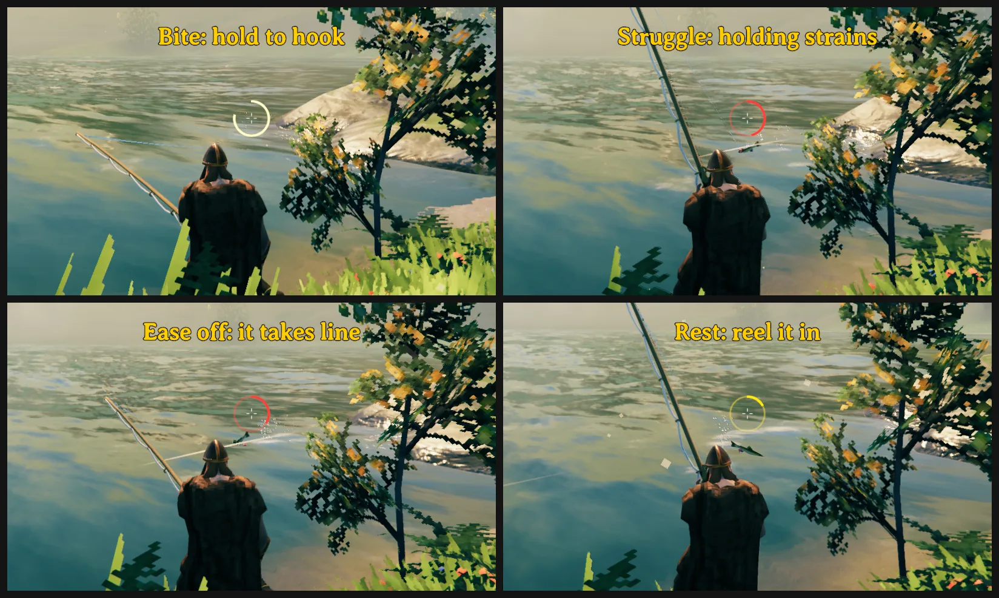

# Rodnarök

Rodnarök makes fishing in Valheim something you can read and enjoy. The bait on your hook decides which fish comes, in any water deep enough.

## AI notice

Most of Rodnarök was written by Claude Code (Anthropic), which did the heavy lifting on implementation and design. Heads-up so you can judge for yourself.

## Fishing

Each bait brings its own fish anywhere, and plain *Fishing Bait* also brings the fish that live where the float lands. A school swims in from out of sight, each kind showing its own sign on the water.

When a fish bites, the float goes under and the crosshair ring drains: hold the line to hook it. While the fish struggles the ring is red, and holding strains the line until it snaps, so ease off. While it rests the ring is yellow: hold to reel it in. A still float means the fish rests a while yet; a restless float and a line going taut tell you it is about to bolt. In a rest the secondary attack heaves the fish nearer and leaves slack to wind in quickly, but slack still out when the fish bolts jolts the line. Before the bite the crosshair ring fades in as a fish waiting at your float runs in to it; jig with the same button while it is whole white to hurry the fish, but a jig off cue makes a wary school flinch. A missed bite may cost your bait.

Noise and quick reels scare the fish, and a line at the top left says why a school left. Cast out over deep water and keep still.

You can fish sitting on a chair, a bench or the ground. A *Serpent trophy* on an *Item stand* calms the waves around it once you tap the use key on that stand.

## Difficulty

`Difficulty` picks one of five levels, from `VeryEasy` to `VeryHard`, with `Normal` by default. Picking a level fills in the settings it sets, and changing one of them yourself makes it `Custom`.

## Multiplayer

Install Rodnarök on every player and on a dedicated server. The server's settings apply to everyone on it, and only an admin changes them in game.

## Settings

All settings are in `BepInEx/config/isimp.Rodnarok.cfg`, and `/rodnarok` in the chat tells where. `CastHints`, `SeatedMotions` and `FloatWisp` are your own, never the server's.

## Other mods

The fish a bait brings can only be caught with the rod, so a spear, harpoon, arrow or bolt from Spearfishing that hits one catches nothing and scares the school away. Fish of the world's own are left to Spearfishing as before.

## Thanks

Several ideas come from ChillFishing by Lenson, above all calming the water where you fish.

## More

Technical notes and build instructions are on GitHub at https://github.com/isimp/Rodnarok
